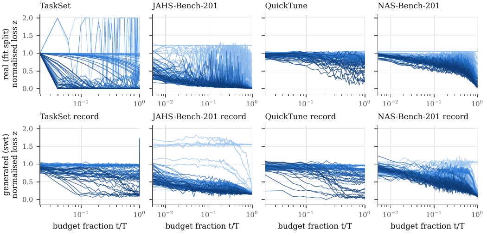

# lcfaker: a data-driven prior of learning curves for freeze-thaw HPO

`lcfaker` generates synthetic hyperparameter-optimization (HPO) tasks: a search space, up to 1000 configurations,
and a full learning curve for every configuration. It is meant as training data ("prior") for learning-curve-based
HPO methods such as FT-PFN / ifBO, and as a cheap testbed for multi-fidelity HPO algorithms.

The generator, **swt** (shape-warp-template), is built from an analysis of about 570 real HPO tasks (TaskSet,
JAHS-Bench-201, QuickTune, NAS-Bench-201). The paper is in [`paper/main.pdf`](paper/main.pdf).



## Install and use

```bash
pip install -e .            # numpy + scipy only
```

```python
from lcfaker import generate

tasks = generate(n_tasks=100, seed=0)
t = tasks[0]
t.y        # [n_configs, T] float32: normalised loss curves, lower is better
t.X        # [n_configs, d] configurations in [0, 1]^d, d <= 10 (dimension 0 acts like a learning rate)
t.source   # family of the real task whose fitted description the task was generated from
t.info     # indices of dead / diverged configurations, record id
```

`generate(n, seed, source_weights={"taskset": 1, "jahs": 1, "quicktune": 1, "nasbench201": 1})` rebalances the
record families. The default follows the number of real tasks per family (96% TaskSet); that is the setting
evaluated in the paper. `python examples/plot_tasks.py` plots a few tasks.

**Units.** Each task's curves are normalised: 0 is about the task's best value, 1 a typical starting loss
(the 90th percentile of first values), 2 marks diverged runs. Curves have T = 50-200 steps depending on the record.

## How a task is generated

1. A **record** is drawn: the fitted description of one real task, consisting of a template curve in log-time,
   the joint distribution of per-curve warps, the shares of dead and diverged configurations, and the noise level,
   time profile and tail weight.
2. Smooth random **Gaussian-process fields** over the configurations set each configuration's final value
   (with a spatially rough part matched to how predictable the real task's landscape is) and its speed.
3. Each **curve** is the template, warped: `y(u) = alpha + a * f((u - beta) * exp(gamma))`, `u = log(t/T)`.
   `beta` shifts the descent in log-time, `gamma` stretches it, `a` and `alpha` set amplitude and level.
4. **Dead** configurations (flat curves) sit at the low end of the learning-rate-like dimension, **diverged**
   ones at its high end. Heavy-tailed (Student-t) noise that shrinks over the budget is added.

No real curve is replayed. What comes from real tasks are the templates and the distributions of warps, class
shares and noise (`lcfaker/assets/swt_v11.npz`, 5 MB).

## How close is it to real data?

Measured on real task families that were not used to build the model (paper, Tables 1-2):

| | real | swt | ifBO prior |
|---|---|---|---|
| HPO regret error (mean abs. difference from real; lower is better) | 0 | 0.031 | 0.088 |
| Hyperband gain over random search | 0.155 | 0.110 | 0.065 |
| freeze-thaw gain over random search | 0.112 | 0.083 | 0.078 |
| landscape predictability (rank corr.) | 0.77 | 0.71 | 0.73 |
| near-best share of configurations | 0.14 | 0.08 | 0.01 |
| curve speed predictable from config (R²) | 0.73 | 0.49 | 0.22 |
| residual excess kurtosis (heavy tails) | 23 | 23 | 0.1 |

**Known gaps:** landscapes are more rugged than real ones, multi-fidelity gains are 25-30% too small, the
templates are re-used from the fit tasks, and minority curve patterns (two-stage plateaus, overfitting) and several
seeds per configuration are not modelled yet.

## Provenance

The fitted records come from public benchmark data: TaskSet (Metz et al., 2020), JAHS-Bench-201 (Bansal et al.,
2022), QuickTune (Pineda Arango et al., 2024) and NAS-Bench-201 (Dong & Yang, 2020). LCBench, PD1 and TaskSet's
FixedTextRNNClassification tasks, the test benchmarks of FT-PFN, were not used in any way.

## Citation

See `paper/main.tex` (draft).
