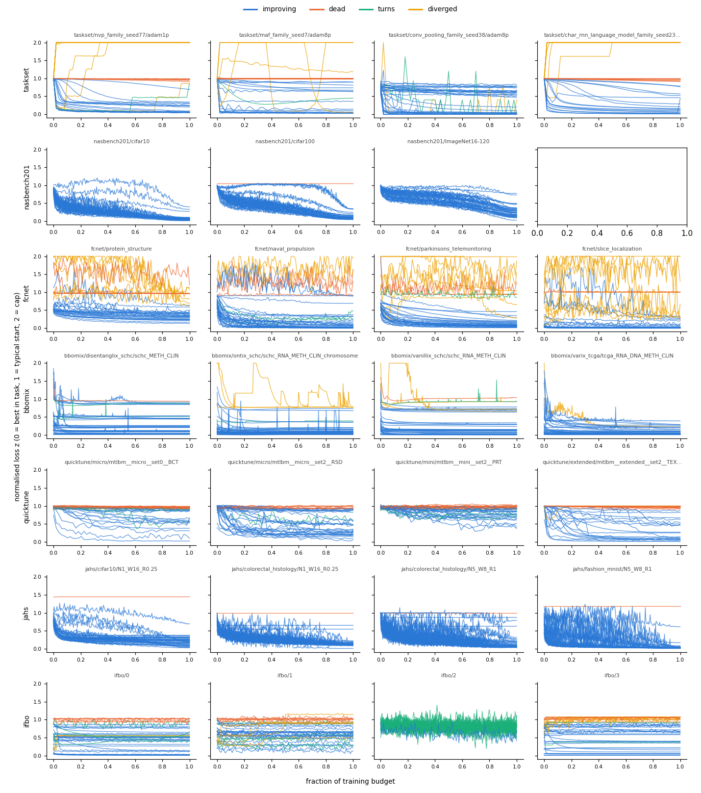

# Journal

The narrative record: what was tried, why, what was learned, which decisions followed. Newest entries at the bottom.

## 2026-11-20: Restart

The first session's work was razed, except the data, its loaders, the held-out guard and the split. It had patched
the ifBO prior and trained rogue-dagger policies to test the patches; both were against the project's intent (see
README, "Why the earlier attempt was razed"). The real-data facts it found are listed in the README. Its code is
in the git history (commits up to `5cbee54`), if a detail is ever needed.

## 2026-11-20: JAHS-Bench-201 added

With the user's approval the JAHS pickles were converted (`scripts/convert_jahs.py`, `scripts/prepare_jahs.py`,
details in `docs/data.md`). 81 tasks, one per (dataset, depth N, width W, resolution), 200 epochs, split *fit*.
Two surprises in the raw data: separate runs stopped at lower budgets (dropped), and repeated configs (exact copies
dropped; distinct runs of one config kept as replicas). fashion_mnist has only 123-407 distinct configs per task.

## 2026-11-20: Data atlas (step 1)

**Question.** What kinds of learning curves exist, per source, and how does the ifBO prior compare?

**Method** (`scripts/atlas.py`, `curvefaker/curves.py`; per-task numbers in `results/atlas_tasks.csv`).
300 TaskSet tasks (150 *fit*, 150 *select*, random), every task of the other sources, and 300 ifBO tasks (1-10
hyperparameters, 1000 random configs, 100 points). At most 1000 configs per task. Each task is normalised:

- **z = (y − best) / (ref − best)**, where *best* is the lowest value anywhere in the task and *ref* is the 90th
  percentile of the configs' first values (a bad starting level: the loss at initialisation, or about chance level
  for classifiers). z = 0 is the task's best, z = 1 a bad start; diverged values are capped at 2.

Each config's curve (mean over seeds) is put in one class. The class is decided on a lightly smoothed curve, so
that noise does not decide it:

- **dead**: never gets below z = 0.9, i.e. never makes 10% of the possible progress;
- **diverged**: blows up (non-finite or z > 2) or ends 0.1 worse than it started;
- **turns**: improves, then gets clearly worse again (overfitting or late instability);
- **improving**: the rest.

Task statistics (the table shows the median over the tasks of a source):

- **final_spread**: 90th minus 10th percentile of the configs' final z. How different good and bad configs are.
- **t50 / t90**: fraction of the budget a curve needs for 50% / 90% of its total improvement (median over configs).
  Small = fast early learning, large = learning happens late.
- **rank_early10 / 30**: rank correlation between z at 10% (30%) of the budget and the final z. How well an early
  look predicts the end, which is what freeze-thaw methods exploit. *_live*: dead configs left out.
- **top10_kept**: of the configs that end in the best 10%, the share already in the best 10% at 10% of the budget.

| source | tasks | improving | dead | turns | diverged | final_spread | t50 | t90 | rank_early10 | rank_early10_live | rank_early30_live | top10_kept |
|---|---|---|---|---|---|---|---|---|---|---|---|---|
| taskset | 300 | 0.60 | 0.19 | 0.01 | 0.15 | 1.21 | 0.06 | 0.30 | 0.89 | 0.87 | 0.94 | 0.65 |
| nasbench201 | 3 | 0.98 | 0.02 | 0.00 | 0.00 | 0.32 | 0.25 | 0.78 | 0.79 | 0.77 | 0.84 | 0.47 |
| fcnet | 4 | 0.76 | 0.06 | 0.04 | 0.10 | 0.91 | 0.10 | 0.50 | 0.93 | 0.92 | 0.96 | 0.76 |
| bbomix | 35 | 0.93 | 0.00 | 0.02 | 0.04 | 0.37 | 0.03 | 0.16 | 0.95 | 0.95 | 0.98 | 0.77 |
| quicktune | 86 | 0.58 | 0.38 | 0.02 | 0.00 | 0.80 | 0.18 | 0.49 | 0.80 | 0.72 | 0.87 | 0.62 |
| jahs | 81 | 0.96 | 0.03 | 0.00 | 0.00 | 0.27 | 0.09 | 0.60 | 0.65 | 0.61 | 0.61 | 0.30 |
| ifbo | 300 | 0.51 | 0.02 | 0.10 | 0.12 | 0.63 | 0.11 | 0.45 | 0.68 | 0.66 | 0.84 | 0.50 |

**What the curves look like** (gallery: 40 random configs from 4 tasks per source, coloured by class):

- **TaskSet**: a fast drop in the first few percent of training, then slow refinement. Dead configs sit exactly at
  the initial loss; diverged ones jump to the cap abruptly, often mid-training (a step, not a drift).
- **NAS-Bench-201 and JAHS** (cosine learning-rate schedules): a large share of the improvement comes at the
  *end*, when the learning rate decays (t90 = 0.6-0.8). Some NAS-Bench-201 curves even rise first and fall late.
  Here curves cross most, and the early look predicts least (JAHS: rank correlation 0.61 at 30% of the budget,
  and only 30% of the final top-10% are in the top 10% early on).
- **FCNet**: very noisy; bad configs bounce around high values rather than sitting flat.
- **bbomix**: converges very fast (t50 = 0.03), then plateaus; occasional single-epoch spikes.
- **QuickTune**: 38% of fine-tuning runs are dead (sit at chance), the highest share of any source.
- **ifBO**: curves often start low already (the first point is not a common bad start), much more "turns"
  (10% vs 0-4% on real data) and noise large relative to the progress made; in some tasks noise is all there is
  (third ifBO panel). Dead configs are rare (2%) vs up to 38% on real sources.

**Conclusions for the faker.**

1. The time profile is source-dependent and driven by the learning-rate schedule: "fast drop then plateau"
   (TaskSet, bbomix) vs "slow, with late improvement" (cosine schedules). A curve model needs both; ifBO's
   saturating basis curves have no late drop.
2. Dead configs (0-38%) and abrupt divergence (up to 15%) are separate phenomena from slow learners and need
   their own model component.
3. How predictive early performance is varies a lot (rank correlation at 10%: 0.65-0.95). This is the property
   freeze-thaw methods depend on, so the faker should cover this range rather than one value.

Caveats: three NAS-Bench-201 and four FCNet tasks are few; the class thresholds (0.9, 0.05, 0.1) are judgment
calls, chosen by looking at the gallery, not tuned on anything held out.

## 2026-11-20: Config → final performance (question A, first pass)

**Question.** Within a task, how do hyperparameters determine the final loss? How predictable is it from a few
hundred configs, does it need interactions, and how many hyperparameters matter? Same questions for ifBO.

**Method** (`scripts/landscape_models.py`, `curvefaker/landscape.py`; per task: `results/landscape_tasks.csv`).
60 TaskSet tasks, 3 NAS-Bench-201, 4 FCNet, 20 bbomix, 40 QuickTune, 27 JAHS, 60 ifBO (1-10 hps). Target: the
final normalised loss, replaced by its **normal score** (rank mapped to a standard-normal quantile). This keeps the
order and stops the few dead or diverged configs from dominating squared errors; without it, the GPs overfit
(checked on one task). Train on 200 random configs (QuickTune: about 100), test on up to 500 others.

- **const**: predict the training mean (floor).
- **rf / lgbm**: random forest / gradient-boosted trees on one-hot configs.
- **gp_full**: Gaussian process with a product kernel over hyperparameters, so any interaction is possible
  (Matern-5/2 per numeric hp, "same or different" kernel per categorical hp).
- **gp_additive**: sum of one kernel per hp, so no interactions.
- **gp_add+full**: both. **interaction_share** = variance of the product part / total.
- **eff_hps**: from the additive part, the "effective number" of hps that matter (exp of the entropy of their
  variance shares; 1 = one hp does everything, 6 = six matter equally). **top_hp_share**: share of the most
  important hp.
- Score: **Spearman rank correlation** between predicted and true test values. The order is what matters to an
  optimiser.

| source | hps | const | rf | lgbm | gp_full | gp_additive | gp_add+full | full − additive | eff_hps | top_hp_share |
|---|---|---|---|---|---|---|---|---|---|---|
| taskset | 6 | 0.00 | 0.86 | 0.84 | 0.83 | 0.59 | 0.82 | 0.19 | 1.8 | 0.83 |
| nasbench201 | 6 | 0.00 | 0.78 | 0.85 | 0.86 | 0.81 | 0.83 | 0.06 | 4.6 | 0.32 |
| fcnet | 9 | 0.03 | 0.92 | 0.94 | 0.95 | 0.88 | 0.95 | 0.08 | 3.3 | 0.51 |
| bbomix | 8 | 0.00 | 0.98 | 0.98 | 0.99 | 0.98 | 0.99 | 0.00 | 2.5 | 0.71 |
| quicktune | 32 | 0.00 | 0.29 | 0.24 | 0.12 | 0.20 | 0.19 | −0.11 | 7.7 | 0.29 |
| jahs | 10 | 0.00 | 0.70 | 0.75 | 0.76 | 0.51 | 0.72 | 0.19 | 5.1 | 0.39 |
| ifbo | 4 | 0.00 | 0.82 | 0.78 | 0.90 | 0.55 | 0.90 | 0.21 | 2.0 | 0.67 |

(median over tasks; "full − additive" is the median per-task difference of rank correlation.)

TaskSet by optimizer family (number of hps): adam1p (1) 0.99; adam4p (4), adam6p (6), adam8p (8), nadamw (10):
0.77-0.82 for gp_full, with the additive model 0.21-0.37 worse. One hp (the learning rate, presumably) carries
60-86% of the additive variance.

**Findings.**

1. **Predictability ranges from almost perfect to almost none**: bbomix 0.99, FCNet 0.95, TaskSet 0.83, JAHS 0.76,
   QuickTune 0.12-0.29 (32 hps, about 100 configs, and the pretrained model, a 24-way categorical, presumably
   dominates). A faker should cover this range. ifBO sits at the easy end (0.90 with 4 hps on average; 0.6-0.85 at
   6-10 hps).
2. **Interactions matter where one hp dominates** (TaskSet, JAHS: additive loses about 0.2). Near-additive
   landscapes exist too (bbomix, NAS-Bench-201, FCNet). ifBO's random networks are strongly non-additive at every
   dimension ≥ 3.
3. **Few hps matter on TaskSet** (eff_hps 1.8); 3-5 matter on FCNet, JAHS and NAS-Bench-201.
4. Trees and GPs are close; the GP is better on smooth numeric spaces, trees on QuickTune.

interaction_share (median per source): bbomix 0.04, FCNet 0.29, NAS-Bench-201 0.30, QuickTune 0.32, ifBO 0.43,
TaskSet 0.50, JAHS 0.60. It orders the sources like the rank-correlation gap, but per task the two correlate only
0.35 (Spearman). So it is a coarse descriptor; the gap measures the predictive effect directly.

Caveat: eff_hps depends on the number of hps.

## 2026-11-20: Curve shapes (question B, first pass)

**Question.** Which curve families can represent real curves, and which extrapolate from the start of a curve?

**Method** (`scripts/curve_shapes.py`; `results/curve_shapes*.csv`). Replica-mean normalised curves, resampled to
50 points evenly over the budget; diverged curves left out. Learned models are fitted on curves of the *fit* split
(about 22k curves) and evaluated on the *select* split (TaskSet select families, FCNet, bbomix).

- **pow3** y = c + a·u^(−b), **exp3** y = c + a·exp(−b u): classic 3-parameter saturating curves, fitted per curve.
- **pca-k**: the mean curve plus k principal components of the fit curves (probabilistic PCA: the latent is
  shrunk toward 0 by its prior when only part of the curve is seen).
- **vae-k**: a variational autoencoder with a k-dimensional latent (2 hidden layers of 256), latent fitted per
  curve under its N(0, I) prior.
- **knn**: average final value of the 50 fit curves most similar on the observed part. **last**: last observed
  value.

Scores: **rmse_full**: error of the best fit to the whole curve (z units; the noise level is 0.003-0.05).
**mae_final**: see the first 20% of the curve, predict the final value, mean absolute error. **rank_final**:
per task, rank correlation of predicted vs true final values (median over tasks).

Held-out select split (all three sources):

| model | rmse_full | mae_final | rank_final |
|---|---|---|---|
| pow3 | 0.046 | 0.076 | 0.87 |
| exp3 | 0.040 | 0.083 | 0.89 |
| pca-2 / 4 / 8 | 0.059 / 0.032 / 0.022 | 0.199 / 0.105 / 0.094 | 0.77 / 0.89 / 0.92 |
| vae-2 / 4 / 8 | 0.045 / 0.029 / 0.028 | 0.084 / 0.075 / 0.073 | 0.89 / 0.86 / 0.88 |
| knn | – | 0.068 | 0.90 |
| last | – | 0.074 | **0.94** |

Leave-one-source-out within *fit* (sources with cosine schedules and fine-tuning):

| model | rmse JAHS / NB201 / QT | mae_final JAHS / NB201 / QT | rank_final JAHS / NB201 / QT |
|---|---|---|---|
| pow3 | 0.069 / 0.081 / 0.049 | 0.170 / 0.313 / 0.120 | 0.50 / 0.83 / 0.86 |
| exp3 | 0.062 / 0.062 / 0.038 | 0.215 / 0.388 / 0.147 | 0.63 / 0.86 / 0.84 |
| pca-8 | 0.042 / 0.023 / 0.022 | 0.148 / 0.275 / 0.121 | 0.55 / 0.83 / 0.86 |
| vae-8 | 0.047 / 0.025 / 0.028 | 0.160 / 0.277 / 0.110 | 0.48 / 0.80 / 0.84 |
| knn | – | **0.119** / 0.255 / **0.098** | 0.58 / 0.86 / 0.86 |
| last | – | 0.210 / 0.378 / 0.115 | 0.65 / 0.84 / 0.88 |

**Findings.**

1. **A few learned shapes represent real curves better than the classic parametric families.** Four components
   already beat the 3-parameter power law and exponential, and they transfer to sources not seen in fitting. On
   late-drop sources the gap is large (NAS-Bench-201: 0.023 vs 0.062-0.081). Saturating curves cannot make the
   late, schedule-driven drop.
2. **The VAE gives nothing over PCA at k ≥ 4.** The space of curve shapes is close to linear and low-dimensional
   (about 4-8 dimensions).
3. **For ranking configs from 20% of their curve, nothing beats the last observed value** on any source, and on
   JAHS nothing gets far above 0.65. Shape models do improve the *level* forecast where curves still fall a lot
   late (knn: JAHS 0.21 → 0.12). For a faker this means the crossing pattern (how much the order changes after the
   early phase) is a property of tasks to model explicitly. It does not follow from a good mean shape.

Caveats: the extrapolation priors are pooled over all sources, not conditioned on the task. A task-aware model
(other curves of the same task as context, as freeze-thaw methods do) is the obvious next step for B.
